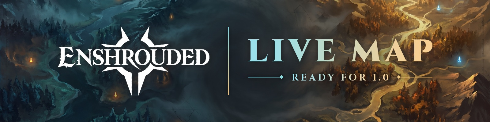
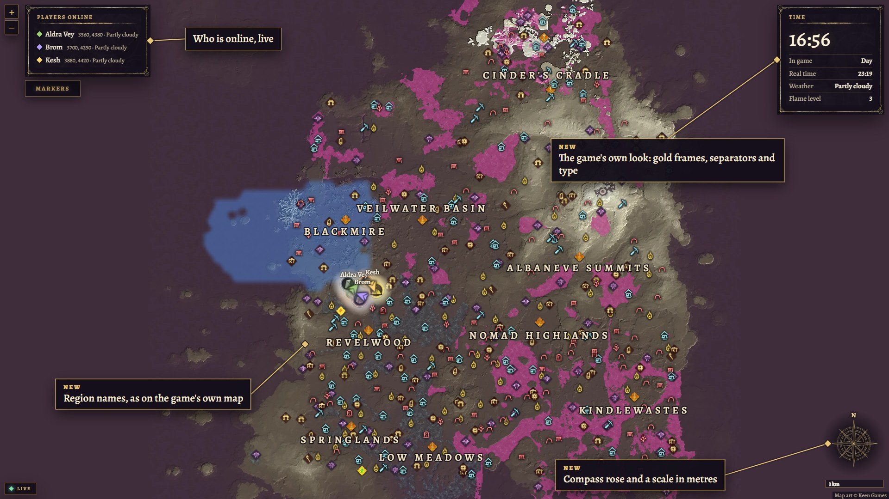
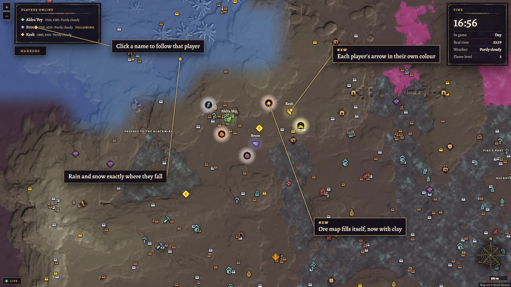
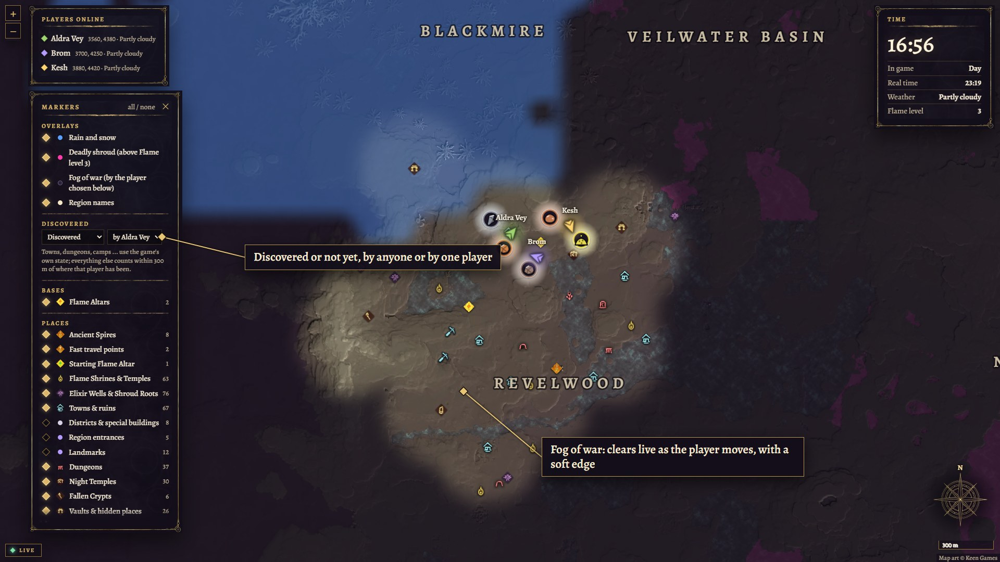
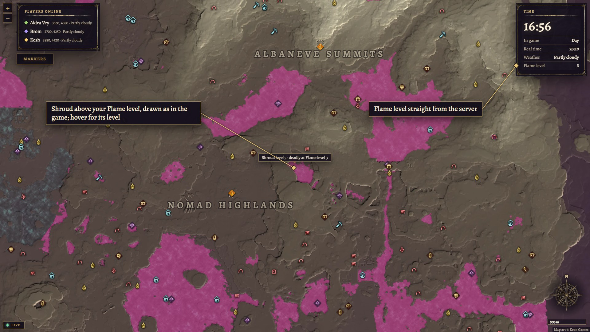
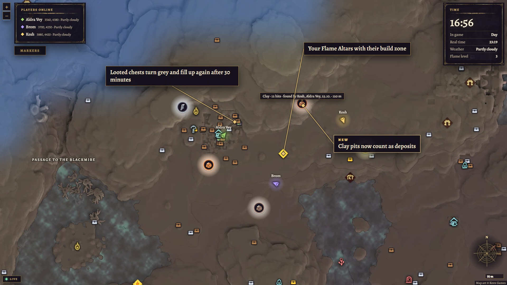
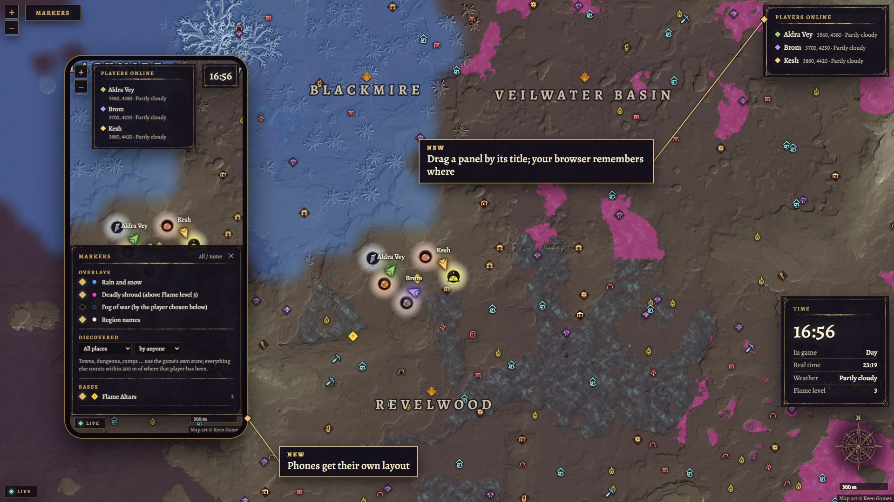
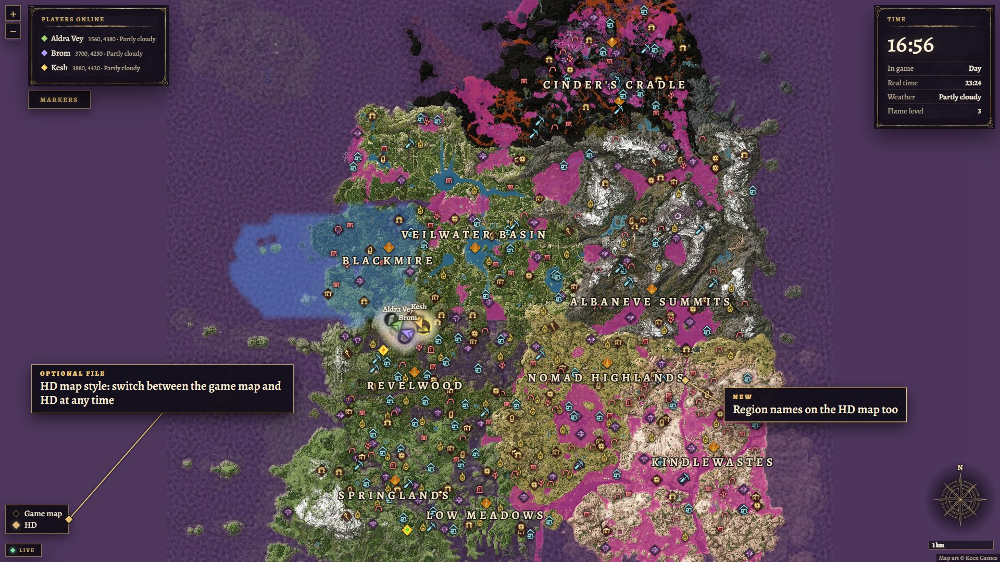

# Enshrouded Live Map

A server-side mod for Enshrouded dedicated servers. The server serves a web map in the game's
own look: players live with names and walking direction, the in-game clock and real time, rain
and snow where they fall, the region names and all map markers from the game's data, the
deadly shroud above your Flame level, fog of war and discovered places per player, and the ore
deposits players mined and the chests they opened. Players install nothing; they open a link
in the browser, on PC, tablet or phone. Also on [Nexus Mods](https://www.nexusmods.com/enshrouded/mods/209).

Sister mod: **[Shared XP](https://github.com/oggii/enshrouded-shared-xp)** shares non-combat XP
with everyone online, also server-side only ([Nexus](https://www.nexusmods.com/enshrouded/mods/178)).



## Install

The mod is `iphlpapi.dll` next to `enshrouded_server.exe`, plus the `livemap` folder (page,
map tiles, icons, marker data).

- **Windows server:** stop the server, copy the files, start it.
- **Linux / Docker (Wine):** also add `iphlpapi=n,b` to `WINEDLLOVERRIDES`
  (several mods: `WINEDLLOVERRIDES=powrprof=n,b;iphlpapi=n,b`).

On the first start the mod writes `livemap.ini` with a random key and logs the link to share.

## Share the map

You share one link. The mod writes it to `livemap.log`:

```
map link: http://203.0.113.5:15637/?key=k3t9x...
```

and shows it in the game chat when a player joins, in a short form to type:
`Live map: 203.0.113.5:15637/k3t9x...`. The game chat cannot copy text, so share the full link
from the log once (Discord, messenger) and let people bookmark it.

The link has three parts, and the mod fills in all three itself:

| Part | Where it comes from | What you do |
|---|---|---|
| Address | the server's public IP, asked from api.ipify.org once an hour | nothing; or set `PublicUrl` |
| Port | `Port=auto`: the same number as the game's `queryPort`, but TCP | open that port for **TCP** too |
| Key | `Key=` in `livemap.ini`, random on the first start | nothing; or set a word you like (see below) |

### Open the port for TCP

The game itself only uses UDP on its query port. The map uses TCP on the same number, so you
usually extend the rule you already have:

- **Home server:** in the router, set the port forwarding of the game port to "TCP and UDP"
  (often called "Both").
- **Docker:** next to `15637:15637/udp` add `15637:15637/tcp`.
- **Rented server with a Pterodactyl panel:** the allocated port is usually open for TCP and
  UDP already; nothing to do.
- **Other hosts:** ask the support to open TCP on the game port, or for one extra TCP port and
  set `Port=` to it.

Check from outside your network (for example on your phone without Wi-Fi): the link must
open the map. Without `?key=...` the server answers 403, which is fine.

### Your own key

`Key=` can be any word: 3 to 64 letters, digits, `-` or `_`, case does not matter.

```ini
Key=ourmap
```

Players can then type `203.0.113.5:15637/ourmap` (or `map.example.com/ourmap` with
`PublicUrl`); the map forwards that to the full link. A short word is easier to type but easier to
guess, and everyone with the key sees all player positions. Changing the key locks old links out.

### A hostname or HTTPS

If the server has a DNS name, or you put the map behind a reverse proxy or a tunnel (for
example a Cloudflare Tunnel to `http://localhost:<Port>`), set

```ini
PublicUrl=https://map.example.com
```

The chat and the log then show `https://map.example.com/?key=...`. `DetectPublicAddress=0`
stops the IP lookup entirely.

### Good to know

- Everyone with the link sees all player positions and Flame Altars. Share it with your players only; change
  `Key=` to revoke it.
- Without a proxy the map is plain HTTP.
- Links in the game chat cannot be clicked: type them, or copy them from `livemap.log`.

## Settings (`livemap.ini`)

| Key | Default | Meaning |
|---|---|---|
| `Enabled` | `1` | `0` turns the mod off. |
| `Port` | `auto` | `auto` = the game's `queryPort` number over TCP; or a fixed number. |
| `PublicUrl` | empty | Address for the link, e.g. `https://map.example.com`. Empty = public IP. |
| `DetectPublicAddress` | `1` | `1` = ask api.ipify.org (then icanhazip.com) for the public IP, once an hour. |
| `AnnounceInChat` | `1` | `1` = the chat shows the map link when a player joins. |
| `Bind` | `0.0.0.0` | Network interface; `127.0.0.1` = only this machine (behind a proxy). |
| `Key` | random | Access key in the link: 3 to 64 letters, digits, `-` or `_`; case does not matter. |
| `UpdateMs` | `250` | How often the page gets new positions (100 to 5000). |
| `Finds` | `1` | Ore deposits and opened chests on the map. |
| `Bases` | `1` | The players' Flame Altars on the map. |
| `Discovered` | `1` | Which places each player discovered and where they have been (filter and fog of war). |
| `Deaths` | `1` | Count each player's deaths (shown next to the name, saved in `livemap/deaths.json`). |
| `Objects` | `1` | Chests looted or not, locks, barriers and switches, and creatures near the players, read from the server's loaded world. |
| `Log`, `LogDiagnostics` | `1` | Log file and periodic diagnostics. |

## The map

The map is drawn from the game's own map data (the textures the in-game map is made of): height,
relief shading, contour lines and the shroud zones, at 1 metre per pixel when zoomed in. The
icons are the game's own map markers. `tools/render_map.py` and `tools/extract_icons.py` make
them from the game files; see `docs/RESEARCH.md`, section 13. The page wears the game's own
map-screen look: its gold frame, separators and player arrow (`livemap/ui/`, from the client's UI
textures) and Alegreya (`livemap/fonts/`, SIL Open Font License), the closest free match to the
game's Harmonique Display.

You can add your own map picture as a second style in `livemap/maps.json`:

```json
{ "name": "My map", "file": "my-map.jpg", "bounds": [[0, 0], [10240, 10240]] }
```

`bounds` is the part of the world the picture covers, in metres (`[[south, west], [north, east]]`).
If it does not sit right, open the map with `&calibrate` added to the link and follow the steps.

Looted chests show as looted for 30 minutes, then as full again (what players see on dedicated
servers; the game data has no fixed time). Chests inside a Flame Altar's build zone stay looted.
Change the time with `"chestRefillMinutes": 60` at the top level of `maps.json`; `0` = never.
The marker panel has switches for the rain and snow overlay and for deadly shroud: shroud zones
above the world's Flame level, drawn pink as on the game's map (zone levels from the game's map
data, `tools/extract_shroud.py`; the Flame level is the first keyword of the server's A2S_INFO).

Click a player in the list to follow them (click again or drag the map to stop). Add
`&follow=<name>` to the link to follow that player whenever they are online. To point someone
at a spot, add `&mark=<x>,<z>,<name>` (several joined by `;`): the map opens there with a ring
and the name on it.

The server also tells which chests are looted (its own state, not a guess: a looted chest stays
looted), which locked doors and chests were picked and which magic barriers and switches were
used, and what lives around the players: enemies, animals and bosses with their health, live. It
only holds the world within about 500 m of each player, so chests and switches show the last
state it saw there; `livemap/objects.json` keeps it.

Each player's deaths since the map was installed show next to their name (☠ 3); hover it for
how (killed, fell, shroud, drowned) and when the last one was. The server reports every death
with its cause; the map counts them and keeps the count across restarts.

### Optional: HD map style

On Nexus Mods there is an optional file with a second, colourful map style: an HD map picture
by Nick (shipped in Aerox912's Sparkweave Minimap, Nexus #143), made sharp with the game's
relief by `tools/enhance_map.py`. Unzip it over the install; it adds `livemap/tiles-hd` and a
`maps.json` with both styles. The picture is not part of this repository.

## Works with Shared XP

[Shared XP](https://github.com/oggii/enshrouded-shared-xp) ([Nexus](https://www.nexusmods.com/enshrouded/mods/178))
1.1.3 or newer. Both mods add a line to the chat after "Player X joined." and can run together; whichever starts
second adds its hook on top of the first one.

## Screenshots

Made from the real page and map with sample players (`tools/perf/promo_shots.mjs`).

| | |
|---|---|
|  |  |
| Players live with their walking direction; click a name to follow | Fog of war and discovered places, per player |
|  |  |
| The deadly shroud above your world's Flame level | Ore veins, looted chests and Flame Altars, saved for everyone |
|  |  |
| Move the panels where you like; a layout for phones | The optional HD map style |

## Build

`build.cmd` (Visual Studio 2022 Build Tools, CMake, Ninja) builds `build\iphlpapi.dll`, runs the
unit tests and builds `build\livemap_selftest.exe`, which checks a server exe on disk:
`livemap_selftest.exe "C:\path\to\enshrouded_server.exe"`.
